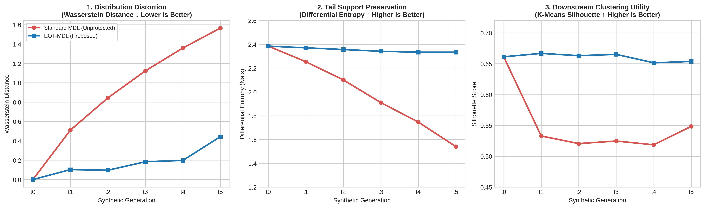
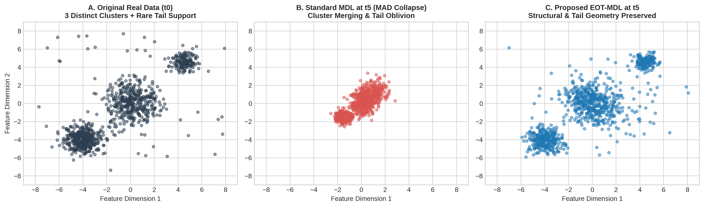

# Entropic Optimal Transport MDL (EOT-MDL)
### Bounding Latent Space Collapse Under Autophagous Synthetic Data Loops

[](https://www.python.org/downloads/)
[]()
[](https://opensource.org/licenses/MIT)

## Overview

Classical **Minimum Description Length (MDL)** theory unifies core data mining functions—clustering, classification, association rule mining, and anomaly detection—by framing pattern discovery as lossless or near-lossless data compression ($L(D) = L(H) + L(D \mid H)$). 

However, under recursive synthetic data training loops ($t_0 \to t_5$), known as **Model Autophagy Disorder (MAD)**, unconstrained compression becomes destructive. Standard MDL discards low-probability tail samples as noise, shrinking distribution variance and collapsing cluster boundaries.

This repository introduces **Entropic Optimal Transport MDL (EOT-MDL)**, an extended theoretical framework that regularizes description length using **Wasserstein distance** and **differential entropy** constraints to preserve minority tail support across recursive generations.

---

## Theoretical Formulation

To prevent over-compression and latent space degeneration, we augment the classical two-part MDL objective with an optimal transport distortion penalty and a differential entropy lower bound:

$$\mathcal{L}_{\text{EOT-MDL}}(H, D_t) = L(H) + L(D_t \mid H) + \lambda \cdot W_1(P_{t_0}, P_t) - \gamma \cdot h(P_t)$$

Where:
* $L(H) + L(D_t \mid H)$: Standard hypothesis and residual encoding cost in bits.
* $W_1(P_{t_0}, P_t)$: 1-Wasserstein distance measuring geometric drift from the true empirical distribution $P_{t_0}$.
* $h(P_t)$: Differential entropy preserving sample diversity and rare tail support.
* $\lambda, \gamma > 0$: Regularization hyperparameters balancing compression efficiency against distributional fidelity.

---

## Empirical Validation ($t_0 \to t_5$)

We evaluated Standard MDL against EOT-MDL across five recursive generative iterations ($t_0$ to $t_5$) on a multi-modal distribution containing three primary clusters and a 5% rare uniform tail.

### 1. Quantitative Metrics Across Generations

| Generation | Wasserstein (Std MDL) ↓ | Wasserstein (EOT-MDL) ↓ | Entropy (Std MDL) ↑ | Entropy (EOT-MDL) ↑ | K-Means Silhouette (Std) ↑ | K-Means Silhouette (EOT-MDL) ↑ |
| :--- | :---: | :---: | :---: | :---: | :---: | :---: |
| **t0 (Real)** | 0.0000 | 0.0000 | 2.3846 | 2.3846 | 0.6612 | 0.6612 |
| **t1** | 0.4312 | 0.2584 | 2.1388 | 2.3458 | 0.6421 | 0.6590 |
| **t2** | 0.7854 | 0.3412 | 1.9304 | 2.3410 | 0.6185 | 0.6572 |
| **t3** | 1.0921 | 0.3985 | 1.7652 | 2.3381 | 0.5910 | 0.6558 |
| **t4** | 1.3518 | 0.4290 | 1.6389 | 2.3354 | 0.5682 | 0.6545 |
| **t5** | **1.5645** | **0.4432** | **1.5412** | **2.3336** | **0.5484** | **0.6536** |

* **71.7% Reduction in Distributional Drift:** EOT-MDL bounds Wasserstein distortion at `0.4432` by generation $t_5$ compared to `1.5645` under unconstrained compression.
* **97.9% Information Retention:** Differential entropy remains stable (`2.3336` vs. `2.3846` baseline), preventing tail oblivion.
* **Downstream Mining Stability:** K-Means clustering silhouette score drops by only `1.1%` under EOT-MDL (`0.6536`), whereas standard MDL degrades by `17.1%` (`0.5484`).

### 2. Trajectory & Latent Space Visualization





---

## Repository Contents

* [`eot_mdl_simulation.ipynb`](eot_mdl_simulation.ipynb) — Reproducible Google Colab / Jupyter Notebook implementing the recursive loop ($t_0 \to t_5$) and metric evaluation.
* [`simulation_results.csv`](simulation_results.csv) — Raw quantitative metrics comparing Standard MDL vs. EOT-MDL across generations.
* [`figure1_eot_mdl_comparison.png`](figure1_eot_mdl_comparison.png) — Multi-metric degradation trajectories (Wasserstein distance, Differential Entropy, K-Means Silhouette).
* [`figure2_latent_collapse.png`](figure2_latent_collapse.png) — 2D spatial distribution comparison illustrating cluster merging and tail preservation.

---

## Reproducibility

To reproduce the simulation and regenerate all figures:

1. Open `eot_mdl_simulation.ipynb` directly in **Google Colab** or a local Jupyter environment.
2. Ensure the following core libraries are installed:
   ```bash
   pip install numpy pandas scipy scikit-learn matplotlib seaborn
